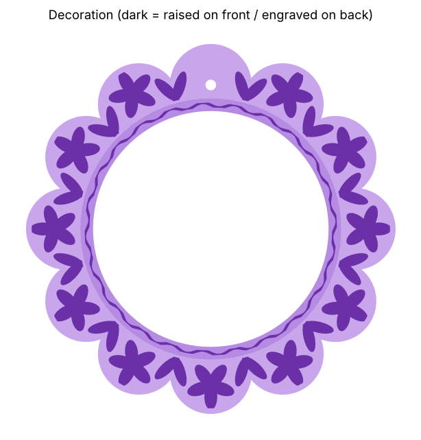
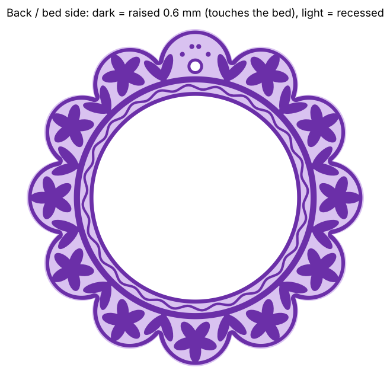
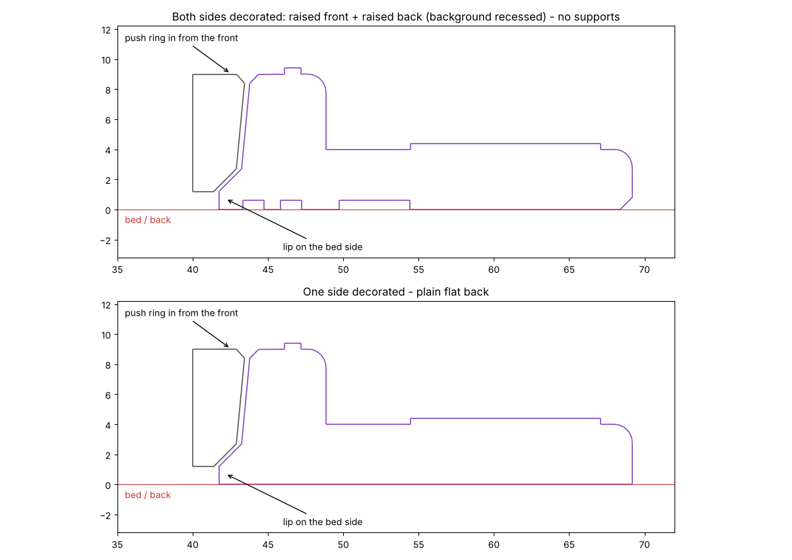

# طارات تطريز على شكل وردة — Bambu Lab A1



قطعتين لكل طارة: **إطار حتة واحدة** + **حلقة بتتكبس من الوش** وبتبقى على مستوى واحد مع وش الإطار. الحلقة وفتحة الإطار مخروطيين (Taper 0.6 مم)، فكل ما تكبس أكتر القماش بيتزنق أكتر، وفيه **حافة (Lip) في الضهر** (على البليتة) الحلقة بتقف عليها ومابتطلعش من الضهر.
الزخرفة: وردة صغيرة على كل بتلة + ورقتين بين كل بتلتين + خط متموّج على الحافة، بارزة 0.4 مم.

| النوع | الوش | الضهر | دعامات |
|---|---|---|---|
| مزخرفة من الناحيتين (`2side`) | حافة بارزة + زخرفة بارزة | نفس الزخرفة **بارزة** 0.6 مم (الأرضية بينها غاطسة) + حرف مشطوف | من غير دعامات |
| مزخرفة من ناحية واحدة (`1side`) | حافة بارزة + زخرفة بارزة | مستوي | من غير دعامات |





المقاسات (فتحة القماش): 60 / 80 / 100 مم → قطر الوردة 113 / 139 / 165 مم. كل مقاس الإطار + الحلقة على بليتة A1 واحدة.

## الملفات
- `طارات_تطريز_وردة_Bambu_A1.zip` — فولدر لكل نوع، جواه فولدر لكل مقاس فيه 3MF جاهز + STL للإطار والحلقة + ملف "اقرأني".
- `ملفات_STL_طارات_التطريز.zip` — ملفات STL بس (6 إطارات + 3 حلقات).
- `نسخة_احتياطي_من_غير_زخرفة.zip` — نفس الطارات من غير زخرفة (لو الـ Slicer لسه بيعلّق).
- `stl/` — الملفات الأصلية بأسماء إنجليزي.

## إعدادات Bambu Studio
PLA، `0.20mm Standard @BBL A1`، 3 walls، 15% infill (Grid)، Top surface = Monotonic line، Ironing مقفول، Textured PEI.
Support مقفول للنوعين.
ماتعملش Scale — هيبوّظ تركيب الحلقة. الخلوص للقماش `FABRIC_GAP` في `make_hoops_v2.py` (0.35 مم).

## إعادة التوليد
```bash
pip install manifold3d trimesh shapely numpy networkx lxml
python3 make_hoops_v2.py            # المزخرف
python3 make_hoops_v2.py --smooth   # من غير زخرفة
python3 package_zips.py             # الملفات المضغوطة بالأسماء العربي
```
`make_hoops.py` و `make_hoops_relief.py` و `make_hoops_2part.py` نسخ قديمة (v1) — الأطراف المدوّرة فيها درجات 0.2 مم والنقشة كثيفة، وده كان بيعلّق Bambu Studio عند "Generating infill regions".
