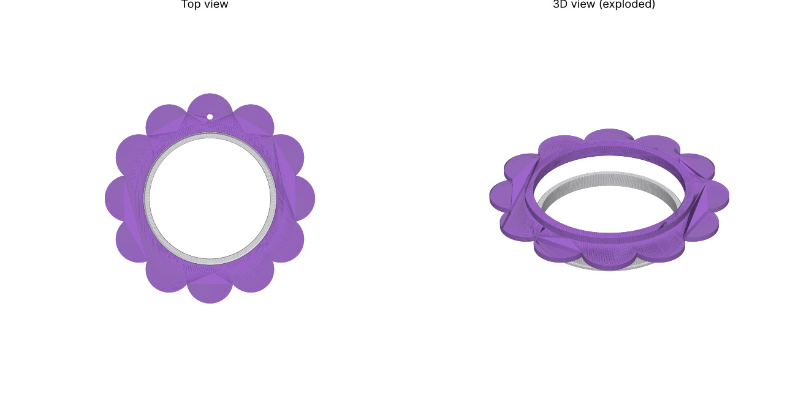
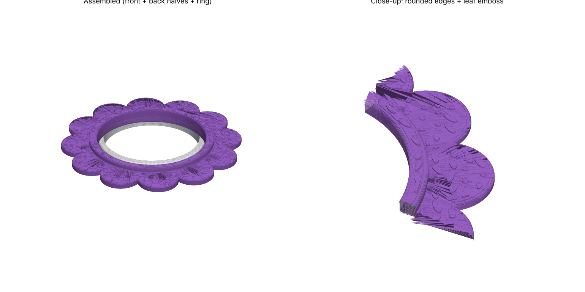

# طارات تطريز على شكل وردة (Scalloped Embroidery Hoops) — Bambu Lab A1



كل طارة جزءين بيتطبعوا **من غير دعامات (No supports)**:

| الملف | الوصف |
|---|---|
| `stl/hoop_XXmm_frame.stl` | الإطار الخارجي (الوردة) + الحافة الدائرية المرفوعة + خرم التعليق |
| `stl/hoop_XXmm_ring.stl`  | الحلقة الداخلية (البيضا) بشفة صغيرة من تحت |
| `stl/hoop_XXmm_plate.3mf` | الجزءين جنب بعض على بليتة واحدة — افتحه مباشرة في Bambu Studio |

المقاسات (XX = قطر فتحة القماش):

| المقاس | القطر الخارجي للوردة | ملاحظة |
|---|---|---|
| 60 mm  | ~113 mm | حجم الميدالية/التعليقة اللي في الصورة تقريبًا |
| 80 mm  | ~139 mm | |
| 100 mm | ~165 mm | |

كلهم يدخلوا براحة على بليتة الـ A1 (256×256 mm).

## إعدادات الطباعة (Bambu Studio)
- **الخامة:** PLA (أو PLA Matte عشان شكل قريب من الصورة). PETG لو عايز مرونة أكتر.
- **البروفايل:** `0.20mm Standard @BBL A1` — فوهة 0.4
- **Wall loops:** 3 — **Infill:** 15–20% Gyroid
- **Supports:** Off — **Plate:** Textured PEI
- **الاتجاه:** زي ما هو في الملف (الوردة نايمة على وشها المسطح، والحلقة على الشفة).
- **لونين؟** اطبع الإطار بلون (موف/وردي/بيج) والحلقة أبيض. لو معاك AMS lite ممكن تعين لون لكل جزء في ملف الـ 3MF، ولو لأ اطبعهم على مرتين.
- **ملمس زي الجلد اللي في الصورة (اختياري):** من تبويب Others → `Fuzzy Skin` = **Contour**، `Thickness 0.2`، `Point distance 0.3`.

## طريقة الاستخدام
1. حط الحلقة البيضا على الترابيزة والشفة لتحت.
2. افرد القماش فوقها.
3. اضغط الإطار (الوردة) من فوق لحد ما ينزل على الحلقة والقماش مشدود بينهم.
4. اقطع القماش الزيادة من ورا، وعلّق من الخرم بسلسلة/شنكل زي الصورة.

## لو المقاس مش مظبوط
الخلوص بين الحلقة والإطار للقماش = `FABRIC_GAP = 0.55 mm` لكل جنب (مناسب لقماش قطن عادي).
- القماش تقيل/الحلقة مش داخلة → زوّده لـ `0.7–0.8`
- الحلقة سايبة → قلّله لـ `0.4`

عدّل القيمة (أو المقاسات `SIZES`، عدد البتلات `PETALS`) في `make_hoops.py` وشغّل:
```bash
pip install manifold3d trimesh shapely numpy networkx lxml
python3 make_hoops.py
```
> ⚠️ متعملش Scale للموديل في Bambu Studio — ده هيبوّظ الخلوص بين الجزءين. غيّر المقاس من السكربت.

---

# ✨ النسخة المجسّمة من الناحيتين (Relief)



شكلها واحد من الوش والضهر: الحافة الدايرية بارزة من الناحيتين، الأطراف مدوّرة، وعليها نقشة ورق بارزة 0.4 مم.
الإطار بيتطبع **نصّين متطابقين** (كل نص وشّه المسطح على البليتة والنقشة لفوق) → من غير دعامات، وبعدين يتلزقوا ضهر لضهر.

| الملف | اطبع كام |
|---|---|
| `stl/hoop_XXmm_relief_half.stl` | **2** (وش + ضهر) |
| `stl/hoop_XXmm_relief_ring.stl` | 1 |
| `stl/hoop_XXmm_relief_plate.3mf` | 60 و 80 مم: الكل على بليتة واحدة |
| `stl/hoop_100mm_relief_plate_1of2.3mf` + `_2of2.3mf` | 100 مم: بليتتين (مش هيدخلوا على بليتة واحدة) |

**المقاسات:** تخانة الحافة 9 مم (4.5 لكل نص) — تخانة البتلات 4 مم — الحلقة ارتفاعها 9 مم ومشطوفة من الناحيتين.

**التجميع:**
1. حط 3 حتت فتلة 1.75 مم (طول كل واحدة 5.5 مم) في خروم التثبيت اللي في الحافة.
2. الزق النصين ضهر لضهر بغرا CA (سوبر جلو) واضغطهم دقيقة.
3. حط القماش على الحلقة البيضا وادخل الإطار عليها لحد ما يبقوا على مستوى واحد.

**إعدادات إضافية:** خلّي `Top surface pattern = Monotonic line` علشان النقشة تطلع نضيفة، و `Ironing` يفضل **مقفول** (هيبوّظ النقشة).
لو عايزها ناعمة من غير نقشة: `EMBOSS = False` في `make_hoops_relief.py`.
