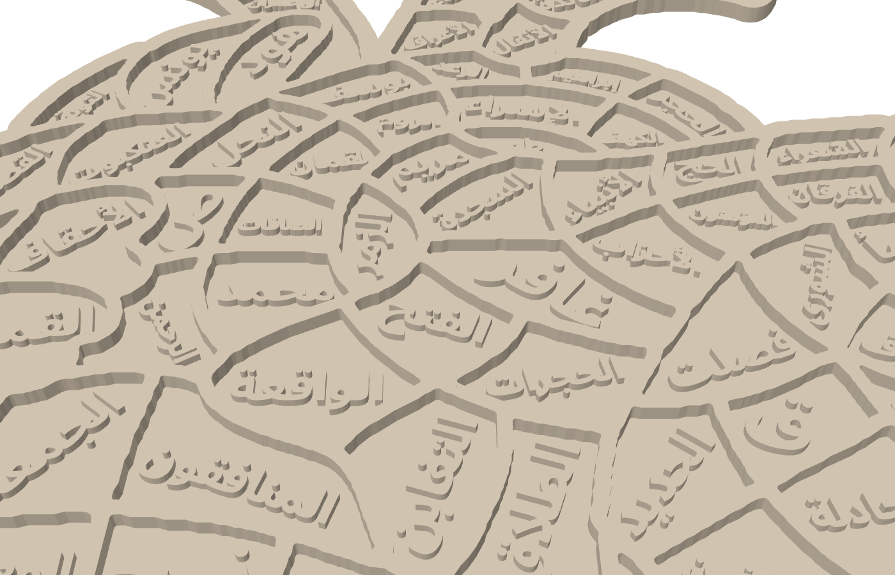
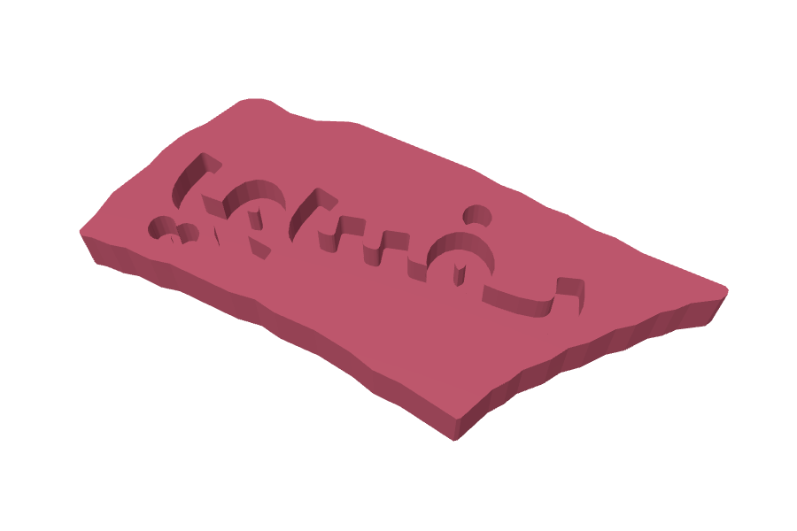

# قلب القرآن – لوحة حفظ السور (Bambu Lab A1)

قلب على شكل الصورة المرجعية (`reference.jpg`)، فيه 114 خانة بعدد سور القرآن.
كل خانة مكتوب في أرضيتها اسم السورة بارز 3 طبقات كدليل، وفيها مسمار مدوّر صغير بعيد عن الاسم، وعلى جدرانها ضلوع رفيعة.
كل ما تحفظ سورة، تركّب قطعتها في خانتها: المسمار بيدخل في ثقب تحت القطعة فتقعد في مكانها بالظبط، والضلوع بتمسكها ضغط.
وفوق القلب علّاقة منفصلة مكتوب عليها «بسم الله الرحمن الرحيم» تتعلّق منها اللوحة على الحيطة.


## الملفات

| الملف | الوصف |
|---|---|
| `board.stl` | القلب قطعة واحدة: قاعدة 0.8 مم + حواف ارتفاعها 2.0 مم + اسم كل سورة بارز 0.6 مم في أرضية خانتها + مسمار مدوّر 1.0 مم في كل خانة + ضلوع على الجدران. المقاس **187 × 258.5 × 2.8 مم** شامل وصلتين التعليق. الملف متلفّ 135° على الطبق (218 × 218 مم) عشان يدخل على طبق A1. ونسخة واقفة للرجوع ليها في `board_upright.stl`. في ظهره كلمة **ZeroCut** محفورة 0.2 مم |
| `hanger.stl` | العلّاقة: لوحة «بسم الله الرحمن الرحيم» 130 × 38 مم مستوية مع القلب، وفيها ثقب تعليق Ø5 مم. بتتركّب في الوصلتين اللي فوق القلب بزرارين بازل بيدخلوا **ضغط** (خلوص 0.07 مم). فتحتين الوصلتين في القلب **مقفولين من ورا** (قاعدة 0.8 مم)، فالزرار ما يعدّيش، ورأسه بيمنع القلب يقع |
| `box_base.stl` | صندوق على شكل قلب ♥ تحفظ فيه القطع: 100 × 86 × 34 مم، جدار 2 مم، وفي حافته فتحة صغيرة للصباع عشان ترفع الغطا. تحت الصندوق ZeroCut محفورة 0.2 مم |
| `box_lid.stl` | غطا الصندوق، متقلّب جاهز للطباعة (وشه على الطبق). بيدخل في الصندوق بشفة عمقها 6 مم ويتقفل ضغط. محفور عليه «خيركم من تعلم القرآن وعلمه» |
| `box_hinged_base.stl` | **تصميم تاني للصندوق، بغطا متوصل بمفصلة وكليبس قدّام:** نفس القلب ♥ وسنّه من قدّام متسطّح شوية، ووراه مفصلتين (واحدة فوق كل فص)، وقدّام عليه مجرى للكليبس |
| `box_hinged_lid.stl` | غطا الصندوق المفصلي، متقلّب جاهز للطباعة. بيلفّ على المفصلتين، وقدّامه لسان عرضه 9 مم جواه نتوء بيطقّ في مجرى الصندوق فيقفل. عشان تفتحه، شدّ طرف اللسان لبرّه بصباعك |
| `stand.stl` | استاند المكتب على شكل **هلال شايل القلب**: الهلال متوصل بالاستاند، بيبدأ من تحت سن القلب ويطلع على الجنب اليمين. القلب داخل في مجرى على طول المكان اللي الهلال لامسه فيه، ومسنود على مسند مستخبي وراه. المقاس 172 × 96 × 121 مم. شكل الهلال ومكانه بيتغيّروا من إعدادات `MOON_*` في `stand.py` |
| `hanger_salawat.stl` | علّاقة تانية بنفس الشكل والزرارين، مكتوب عليها «اللهم صلِّ وسلم وبارك على سيدنا محمد» بدل البسملة. موجودة في فولدر كل قلب على مقاسه |
| `pieces_plate_1.stl` | الـ114 قطعة مرصوصة على طبق واحد (250×250 مم) |
| `pieces/NNN_اسم.stl` | كل قطعة لوحدها (الرقم = ترتيب السورة في المصحف) لو حبيت تطبع قطعة معينة أو تعيد طباعة قطعة ضاعت |
| `test_board.stl` + `test_pieces.stl` | **عينة تجربة:** حتة صغيرة من القلب (60 × 46 مم) فيها 5 خانات كاملة (هود، الرعد، يوسف، الروم، النحل) وقطعهم. اطبعها الأول وجرّب المسك قبل ما تطبع القلب كله |
| `test_lugs.stl` | **عينة تجربة للعلّاقة:** أعلى أنبوبتين القلب بس (حتتين صغيرين فيهم فتحتين الكليك). اطبعهم مع `hanger.stl` وجرّب التِك قبل ما تطبع القلب كله |
| `pieces_report.json` | مقاس كل قطعة وحجم الخط المستخدم فيها |
| `build.py` | السكربت اللي بيولّد كل الملفات من الصورة |

## نسختين: صغير وكبير

| | القلب الصغير (الأصلي) | القلب الكبير |
|---|---|---|
| الفولدر | الفولدر الرئيسي | `large/` |
| رسمة القلب | 246 مم | 284 مم (أكبر مقاس يدخل على طبق A1) |
| القلب بالوصلتين | 187 × 258.5 مم | 215 × 296 مم |
| على الطبق (`board.stl` متلفّ) | 218 × 218 مم | 250.5 × 251 مم |
| أصغر خط في القطع | 2.5 مم | 3.3 مم |
| خانات بمسمار / من غير مسمار | 62 / 52 | 69 / 45 |

**ونسختين كمان من غير أي مسمار** (`noposts_small/` و `noposts_large/`): نفس القلبين بالظبط، بس مفيش مسمار في ولا خانة. كل القطع بتمسك بالضلوع اللي عليها الشوكة (الكبسة) بس، وكل الأسماء بحجمها الكامل. العلّاقة والاستاند هما نفسهم بتوع نفس المقاس. اتولّدوا بـ `NO_POSTS=1`.

كل نسخة ليها قطعها وعلّاقتها واستاندها بتوعها، وما ينفعش تخلط بينهم. الارتفاعات وطبقات تغيير اللون واحدة في النسختين.
لتوليد الكبير: `HEART_MAX_SIZE=284 BUILD_OUT=large python3 build.py` ثم `STAND_SRC=large STAND_OUT=large python3 stand.py`.

## المقاسات

| البند | القيمة |
|---|---|
| سُمك القاعدة | 0.8 مم |
| ارتفاع الحواف فوق القاعدة (عمق الخانة) | 2.0 مم |
| سُمك الحواف بين الخانات | 1.6 مم |
| سُمك الإطار الخارجي للقلب | 3.0 مم |
| سُمك القطعة | 2.0 مم (بتبقى مستوية مع سطح الحواف) |
| اسم السورة البارز | 1.0 مم فوق سطح القطعة |
| الخلوص (clearance) بين القطعة والخانة | 0.2 مم من كل ناحية |
| اسم السورة في أرضية الخانة | بنفس حجم الاسم اللي على القطعة في كل الخانات، بارز 0.6 مم (3 طبقات)، دليل بس ومش بيمسك حاجة |
| المسمار في الخانة | مدوّر Ø3.5 مم (أو 3 / 2.5 / 2)، ارتفاع 0.8 مم (4 طبقات)، في مكان فاضي جنب الاسم. موجود في 62 خانة. الـ52 خانة الباقية مالهاش مسمار: 37 سورة اخترتها بالاسم (`NO_POST` في `build.py`) + الخانات اللي مافيهاش مكان للمسمار جنب الاسم الكامل |
| ضلوع الجدران (كبسة) | ضلوع Ø1.0 مم على جدران الخانة (كل 14 مم في خانات المسمار، وكل 8 مم في الخانات اللي من غير مسمار). كل ضلع عليه **شوكة** صغيرة 0.15 مم قريب من الأرضية: من فوق مايلة بالراحة (سهل الدخول)، ومن تحت حادة (صعب الخروج). وفي حرف القطعة مطرح على قد الضلع، وفيه مجرى بتطقّ فيه الشوكة |
| تحت القطعة | مستطيل فاضي عمقه 1.0 مم (5 طبقات) فوق مكان الاسم (الاسم بيدخل جواه من غير ما يلمسه) + ثقب للمسمار أوسع منه 0.1 مم بس (كليبس) وعمقه 1.0 مم (5 طبقات) |
| حفر الماركة في ظهر القلب | ZeroCut، عرض 102 مم، عمق 0.2 مم (مقلوبة في الملف عشان تتقري صح من ورا) |
| العلّاقة | لوح 2.8 مم (زي القلب) + بسملة بارزة 1 مم + زرارين بازل 2.0 مم بيقعدوا على أرضية الفتحة (فتحة مقفولة من ورا) |

* الخانة البيضاوية اللي في آخر أنبوبة "النور" (فتحة الشريان، ومكتوب عليها مفيش حاجة في الصورة) معمولة مصمتة في القلب نفسه.
* اتجاه الكلام في كل قطعة اتختار أوتوماتيك عشان الاسم ياخد أكبر مساحة ممكنة في الخانة.

## إعدادات الطباعة المقترحة (Bambu Studio)

### تغيير اللون (ارتفاع الطبقة 0.2 مم وأول طبقة 0.2)

| الملف | لون الجسم | لون الكلام | الكلام في الطبقات |
|---|---|---|---|
| `board.stl` (القلب) و `test_board.stl` | الطبقات 1 → 4 | **الطبقة 5 (1.00)** لحد **الطبقة 7 (1.40)** | ارجع للون القلب عند **الطبقة 8 (1.60)** لحد الآخر (الطبقة 14) |
| `pieces_plate_1.stl` (القطع) و `test_pieces.stl` | الطبقات 1 → 10 | **الطبقة 11 (2.20)** لحد الآخر **الطبقة 15 (3.00)** | من غير رجوع |
| `hanger.stl` (العلّاقة) | الطبقات 1 → 14 | **الطبقة 15 (3.00)** لحد الآخر **الطبقة 19 (3.80)** | من غير رجوع |


**القلب (`board.stl`) والعلّاقة (`hanger.stl`)**
* ارتفاع الطبقة 0.2 مم (أو 0.16 عشان الأسماء اللي في الخانات)، Infill ‏15%، بدون دعامات.
* القاعدة 0.8 مم بس، فخلي أول طبقة نضيفة والطبق نضيف عشان القلب ميتلويش وإنت بتشيله.
* العلّاقة بتتطبع على ضهرها والبسملة لفوق. عشان البسملة بلون مختلف: Add color change عند **الطبقة 15 (3.00)**.
* التركيب: حط القلب على ضهره، وحط زرارين العلّاقة في الفتحتين اللي فوق الأنبوبتين من قدّام، واضغط لحد ما يقعدوا على أرضية الفتحة. لو ناشف قوي، اصنفر الزرار خفيف.

**القطع (`pieces_plate_1.stl`)**
* ارتفاع الطبقة 0.12 – 0.16 مم عشان الكلام يطلع واضح.
* **علشان الأسماء تطلع بلون مختلف:** في شريط الطبقات على اليمين، روح للطبقة 11 اللي على ارتفاع **2.20 مم**، كليك يمين ← *Add color change* (أو *Add pause* لو مفيش AMS lite). كده جسم القطعة لون والاسم لون تاني.
* بعد الاستيراد لو عايز تحرك القطع لوحدها: كليك يمين ← *Split to objects*.
* القطعة بتتطبع على وشها التحتاني (الحفر لتحت على الطبق)، ومش محتاجة دعامات.
* أصغر خط في القطع الصغيرة (زي الإخلاص والمسد) حوالي 2.5 مم، فالأفضل تطبع القطع بسرعة هادية. لو عندك نوزل 0.2 الكلام هيطلع أدق.

**الصندوق والغطا (`box_base.stl` و `box_lid.stl`)**
* ارتفاع الطبقة 0.2 مم، Infill ‏15%، بدون دعامات. الغطا بيتطبع على وشه، فالكتابة المحفورة بتطلع في أول طبقات.
* الصندوق بيشيل حوالي 130 سم³، والقطع كلها حوالي 35 سم³، فالـ114 قطعة هيدخلوا براحتهم.
* لو الغطا ناشف في القفل زوّد `LID_CLEAR` في `box.py` لـ 0.25، ولو سايب نزّله لـ 0.1، وبعدين شغّل `python3 box.py`.

**الصندوق المفصلي (`box_hinged_base.stl` و `box_hinged_lid.stl`)**
* نفس الإعدادات: 0.2 مم وبدون دعامات. المفصلات اللي في الصندوق معمولة بميل 45° تحتها، فبتطبع من غير دعامات.
* **المسمار:** حتتين فلامنت 1.75 مم، طول كل واحدة 23 مم. اقفل الغطا على الصندوق، ودخّل الفلامنت من جنب كل مفصلة لحد ما يعدّي من التلات حلقات.
* ثقب الصندوق 1.95 مم، فبيمسك الفلامنت. وثقب الغطا 2.25 مم، فالغطا بيلفّ بحرية.
* الغطا بيتفتح لورا لحد ما يقعد على الترابيزة ورا الصندوق، فالصندوق مش بيتقلب.
* **الكليبس اللي قدّام:** اللسان سُمكه 1.4 مم فبيتني شوية وهو بيقفل، والنتوء 0.5 مم بيدخل في مجرى 0.65 مم. لو القفلة ناشفة أوي صغّر `CLIP_RIDGE` لـ 0.35، ولو سايبة كبّره لـ 0.6، وشغّل `python3 box.py`.
* لو الفلامنت مش داخل، وسّع الثقب بمثقاب 2 مم أو بسلك سخن. ولو سايب ويقع، اطبع الصندوق تاني بعد ما تصغّر `PIN_HOLE_BOX` لـ 1.85.

**الاستاند الهلال (`stand.stl`)**
* اتطبع زي ما هو، القاعدة على الطبق، ومن غير دعامات. وزنه حوالي 68 جم بـ 15% infill، وحوالي ساعة و50 دقيقة طباعة.
* حط القلب من فوق في مجرى الهلال، وسيبه يميل ويسند على المسند اللي وراه.
* الحافة اللي قدّام بتغطي إطار القلب بس، فكل الخانات باينة.
* مركز تقل القلب فوق القاعدة، فمش هيقع.
* شيل العلّاقة قبل ما تحط القلب على الاستاند.
* لو القلب ضيق في المجرى، زوّد `SLOT_CLEAR` في `stand.py` لـ 0.45، وشغّل `python3 stand.py`.

> نصيحة: اطبع قطعة أو اتنين الأول (من فولدر `pieces`) وجرّب تركيبها في القلب. لو القطعة ناشفة في الخانة كبّر `RIB_SEAT_R` لـ 0.5، ولو سايبة صغّره لـ 0.4. ولو المسمار ناشف في الثقب كبّر `PEG_HOLE_EXTRA` لـ 0.2، وبعدين أعد التوليد بـ `python3 build.py`.

## إعادة التوليد / التعديل

```bash
pip install opencv-python-headless shapely trimesh scipy manifold3d mapbox-earcut fonttools uharfbuzz matplotlib
# الخطوط: Noto Sans Arabic Bold + Amiri Bold (apt install fonts-noto-core fonts-hosny-amiri)
python3 build.py      # يولّد board.stl و hanger.stl و pieces/ و pieces_plate_*.stl
python3 preview.py    # صورة معاينة images/preview_assembled.png
python3 box.py        # يولّد التصميمين: box_base/box_lid و box_hinged_base/box_hinged_lid
python3 stand.py      # يولّد stand.stl
```

كل المقاسات في أول `build.py` (قسم CONFIG). `cells.json` فيه نقطة داخل كل خانة في الصورة واسم السورة بتاعتها.

## صور

| معاينة الأسماء | القلب فاضي | قرب | تحت القطعة |
|---|---|---|---|
|  |  |  |  |
