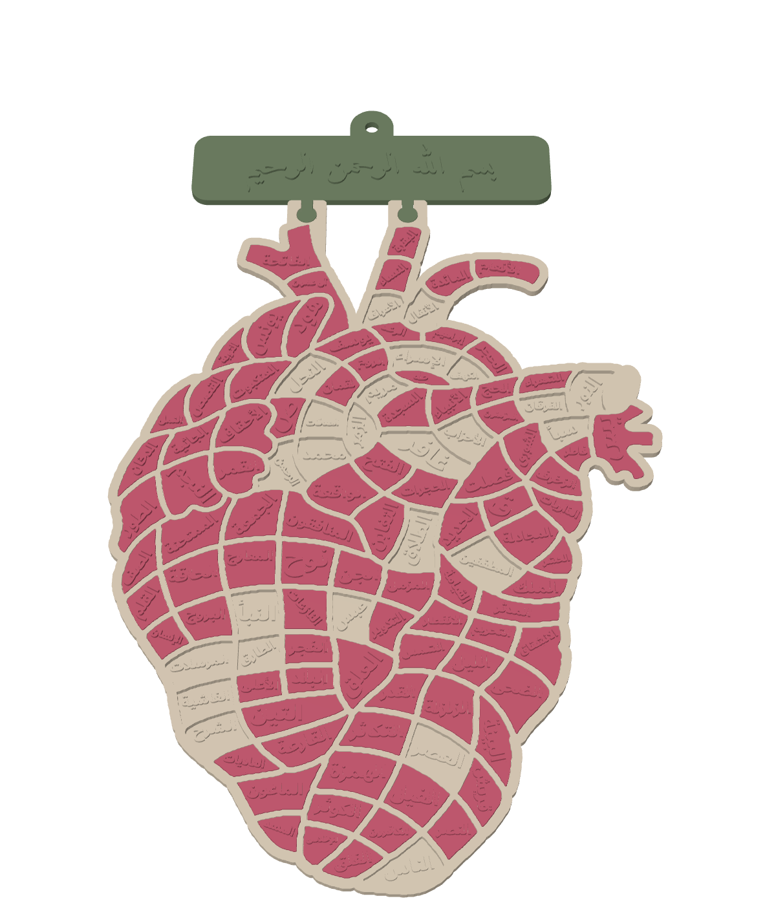
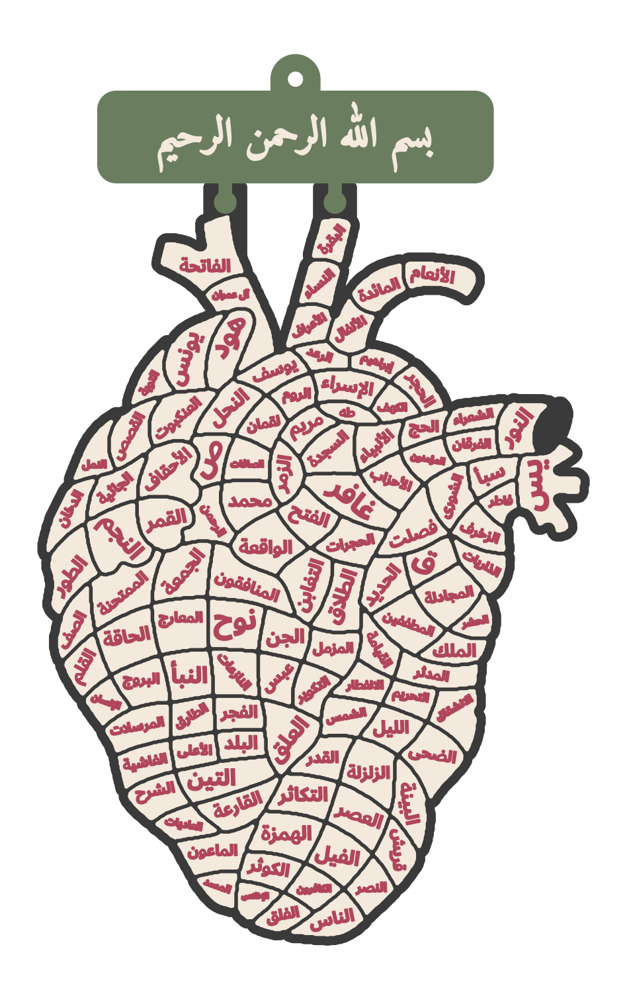
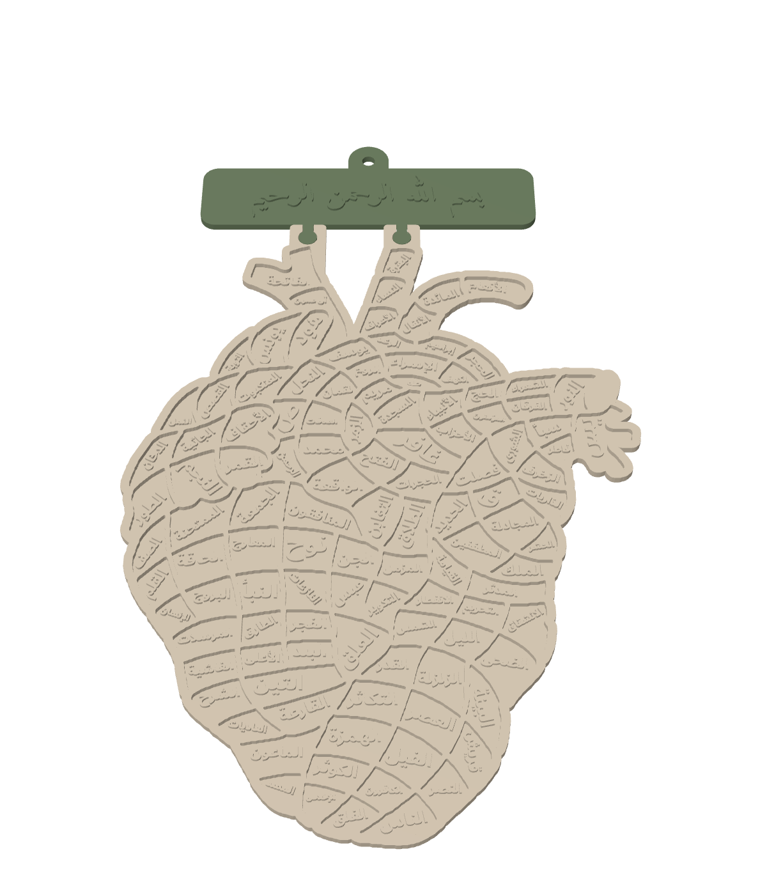

# قلب القرآن – لوحة حفظ السور (Bambu Lab A1)

قلب على شكل الصورة المرجعية (`reference.jpg`)، فيه 114 خانة بعدد سور القرآن.
كل خانة مكتوب في أرضيتها اسم السورة بارز، وتحت كل قطعة نفس الاسم محفور.
كل ما تحفظ سورة، تركّب قطعتها على اسمها في القلب فتقعد عليه وتثبت.
وفوق القلب علّاقة منفصلة مكتوب عليها «بسم الله الرحمن الرحيم» تتعلّق منها اللوحة على الحيطة.



## الملفات

| الملف | الوصف |
|---|---|
| `board.stl` | القلب قطعة واحدة: قاعدة 0.8 مم + حواف ارتفاعها 2 مم + اسم كل سورة بارز 1 مم في أرضية خانتها. المقاس **181 × 250.5 × 2.8 مم** شامل وصلتين التعليق (يدخل على طبق A1 مقاس 256×256). في ظهره كلمة **ZeroCut** محفورة 0.2 مم |
| `hanger.stl` | العلّاقة: لوحة «بسم الله الرحمن الرحيم» 130 × 38 مم فيها ثقب تعليق Ø5 مم، وبتتركّب في القلب من فوق بوصلتين (زي وصلة البازل) |
| `box_base.stl` | صندوق على شكل قلب ♥ تحفظ فيه القطع: 100 × 86 × 34 مم، جدار 2 مم، وفي حافته فتحة صغيرة للصباع عشان ترفع الغطا. تحت الصندوق ZeroCut محفورة 0.2 مم |
| `box_lid.stl` | غطا الصندوق، متقلّب جاهز للطباعة (وشه على الطبق). بيدخل في الصندوق بشفة عمقها 6 مم ويتقفل ضغط. محفور عليه «خيركم من تعلم القرآن وعلمه» |
| `box_hinged_base.stl` | **تصميم تاني للصندوق، بغطا متوصل بمفصلة:** نفس القلب ♥، ووراه مفصلتين، واحدة فوق كل فص من فصّين القلب |
| `box_hinged_lid.stl` | غطا الصندوق المفصلي، متقلّب جاهز للطباعة. بيلفّ على المفصلتين ويتقفل على الصندوق |
| `stand.stl` | استاند المكتب على شكل **هلال** أصغر من القلب: قوسه 135° (بين 90 و180)، والقلب قاعد في تجويفه وقرونه طالعة على الجنبين. ورا القلب مسند مستخبي ودعامة، وتحته قاعدة بيضاوية. المقاس 127 × 96 × 85 مم. شكل القوس بيتغيّر من `MOON_SPAN` و `MOON_R` في `stand.py` |
| `pieces_plate_1.stl` | الـ114 قطعة مرصوصة على طبق واحد (250×250 مم) |
| `pieces/NNN_اسم.stl` | كل قطعة لوحدها (الرقم = ترتيب السورة في المصحف) لو حبيت تطبع قطعة معينة أو تعيد طباعة قطعة ضاعت |
| `pieces_report.json` | مقاس كل قطعة وحجم الخط المستخدم فيها |
| `build.py` | السكربت اللي بيولّد كل الملفات من الصورة |

## المقاسات

| البند | القيمة |
|---|---|
| سُمك القاعدة | 0.8 مم |
| ارتفاع الحواف فوق القاعدة (عمق الخانة) | 2.0 مم |
| سُمك الحواف بين الخانات | 1.6 مم |
| سُمك الإطار الخارجي للقلب | 3.0 مم |
| سُمك القطعة | 2.0 مم (بتبقى مستوية مع سطح الحواف) |
| اسم السورة البارز | 1.0 مم فوق سطح القطعة |
| الخلوص (clearance) بين القطعة والخانة | 0.2 مم من كل ناحية |
| اسم السورة في أرضية الخانة | بارز 1.0 مم |
| الحفر تحت القطعة | نفس الاسم، عمق 1.2 مم، أوسع بـ 0.12 مم من كل ناحية |
| حفر الماركة في ظهر القلب | ZeroCut، عرض 102 مم، عمق 0.2 مم (مقلوبة في الملف عشان تتقري صح من ورا) |
| العلّاقة | سُمك 2.8 مم (زي القلب) + بسملة بارزة 1 مم، وصلتين بازل بخلوص 0.15 مم |

* الخانة البيضاوية اللي في آخر أنبوبة "النور" (فتحة الشريان، ومكتوب عليها مفيش حاجة في الصورة) معمولة مصمتة في القلب نفسه.
* اتجاه الكلام في كل قطعة اتختار أوتوماتيك عشان الاسم ياخد أكبر مساحة ممكنة في الخانة.

## إعدادات الطباعة المقترحة (Bambu Studio)

**القلب (`board.stl`) والعلّاقة (`hanger.stl`)**
* ارتفاع الطبقة 0.2 مم (أو 0.16 عشان الأسماء اللي في الخانات)، Infill ‏15%، بدون دعامات.
* القاعدة 0.8 مم بس، فخلي أول طبقة نضيفة والطبق نضيف عشان القلب ميتلويش وإنت بتشيله.
* لون مختلف للبسملة: Add color change عند ارتفاع **2.8 مم** في العلّاقة.
* التركيب: حط القلب على الترابيزة، ودخّل وصلتين العلّاقة في الفتحتين اللي فوق الأنبوبتين من فوق لتحت (من وش القلب). لو الوصلة ناشفة اصنفرها خفيف.

**القطع (`pieces_plate_1.stl`)**
* ارتفاع الطبقة 0.12 – 0.16 مم عشان الكلام يطلع واضح.
* **علشان الأسماء تطلع بلون مختلف:** في شريط الطبقات على اليمين، روح للطبقة اللي على ارتفاع **2.0 مم**، كليك يمين ← *Add color change* (أو *Add pause* لو مفيش AMS lite). كده جسم القطعة لون والاسم لون تاني.
* بعد الاستيراد لو عايز تحرك القطع لوحدها: كليك يمين ← *Split to objects*.
* القطعة بتتطبع على وشها التحتاني (الحفر لتحت على الطبق)، ومش محتاجة دعامات.
* أصغر خط في القطع الصغيرة (زي الإخلاص والمسد) حوالي 2.5 مم، فالأفضل تطبع القطع بسرعة هادية. لو عندك نوزل 0.2 الكلام هيطلع أدق.

**الصندوق والغطا (`box_base.stl` و `box_lid.stl`)**
* ارتفاع الطبقة 0.2 مم، Infill ‏15%، بدون دعامات. الغطا بيتطبع على وشه، فالكتابة المحفورة بتطلع في أول طبقات.
* الصندوق بيشيل حوالي 130 سم³، والقطع كلها حوالي 35 سم³، فالـ114 قطعة هيدخلوا براحتهم.
* لو الغطا ناشف في القفل زوّد `LID_CLEAR` في `box.py` لـ 0.25، ولو سايب نزّله لـ 0.1، وبعدين شغّل `python3 box.py`.

**الصندوق المفصلي (`box_hinged_base.stl` و `box_hinged_lid.stl`)**
* نفس الإعدادات: 0.2 مم وبدون دعامات. المفصلات اللي في الصندوق معمولة بميل 45° تحتها، فبتطبع من غير دعامات.
* **المسمار:** حتتين فلامنت 1.75 مم، طول كل واحدة 23 مم. اقفل الغطا على الصندوق، ودخّل الفلامنت من جنب كل مفصلة لحد ما يعدّي من التلات حلقات.
* ثقب الصندوق 1.95 مم، فبيمسك الفلامنت. وثقب الغطا 2.25 مم، فالغطا بيلفّ بحرية.
* الغطا بيتفتح لورا لحد ما يقعد على الترابيزة ورا الصندوق، فالصندوق مش بيتقلب.
* لو الفلامنت مش داخل، وسّع الثقب بمثقاب 2 مم أو بسلك سخن. ولو سايب ويقع، اطبع الصندوق تاني بعد ما تصغّر `PIN_HOLE_BOX` لـ 1.85.

**الاستاند الهلال (`stand.stl`)**
* اتطبع زي ما هو، القاعدة على الطبق، ومن غير دعامات. وزنه حوالي 45 جم بـ 15% infill، وبياخد حوالي ساعة وربع طباعة.
* حط القلب من فوق في المجرى اللي في أسفل الهلال، وسيبه يميل ويسند على الهلال.
* الحافة اللي قدّام بتغطي إطار القلب بس، فكل الخانات باينة.
* مركز تقل القلب بالقطع فوق نص القاعدة، فمش هيقع.
* شيل العلّاقة قبل ما تحط القلب على الاستاند.
* لو القلب ضيق في المجرى، زوّد `SLOT_CLEAR` في `stand.py` لـ 0.45، وشغّل `python3 stand.py`.

> نصيحة: اطبع قطعة أو اتنين الأول (من فولدر `pieces`) وجرّب تركيبها في القلب. لو القطعة مش راكبة على الاسم زوّد `NAME_CLEAR` لـ 0.18، ولو داخلة في الخانة بالعافية زوّد `CLEARANCE` لـ 0.25، وبعدين أعد التوليد.

## إعادة التوليد / التعديل

```bash
pip install opencv-python-headless shapely trimesh scipy manifold3d mapbox-earcut fonttools uharfbuzz matplotlib
# الخطوط: Noto Sans Arabic Bold + Amiri Bold (apt install fonts-noto-core fonts-hosny-amiri)
python3 build.py      # يولّد board.stl و hanger.stl و pieces/ و pieces_plate_*.stl
python3 preview.py    # صورة معاينة images/preview_assembled.png
python3 box.py        # يولّد التصميمين: box_base/box_lid و box_hinged_base/box_hinged_lid
python3 stand.py      # يولّد stand.stl
```

كل المقاسات في أول `build.py` (قسم CONFIG). `cells.json` فيه نقطة داخل كل خانة في الصورة واسم السورة بتاعتها.

## صور

| معاينة الأسماء | القلب فاضي | قرب | تحت القطعة |
|---|---|---|---|
|  |  |  |  |
